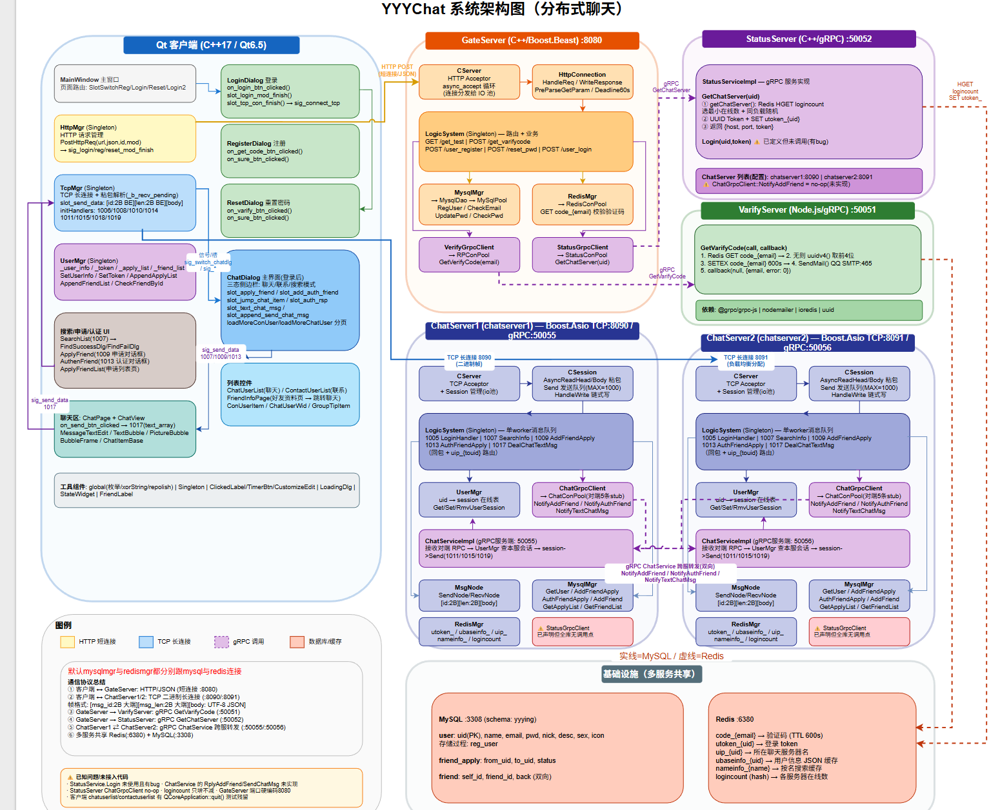

# YYYChat — 即时通讯系统

截至当前阶段（day24），项目已实现了**登录注册、找回密码、用户查找、好友申请 / 认证、好友列表加载以及客户端之间的实时文本聊天**等核心功能，服务端也完成了**双 ChatServer 分布式部署**。整个项目最关键的几条链路都已跑通，本 README 站在当前代码基础上，对客户端与服务端之间的交互以及整体系统架构做一次总览，当然项目在后面还会持续更新，还有文件系统，分布式锁，语音视频通话等等一系列东西需要完成。

## 系统架构图



---

## 项目概述

YYYChat 是一个基于 **C++/Qt 客户端 + 微服务后端**架构的即时通讯（IM）系统。后端采用 **四类微服务**，其中聊天服务（ChatServer）为**分布式多实例**（`ChatServer` / `ChatServer2` 双实例）。服务间通过 **gRPC** 进行内部通信，客户端与服务端之间采用 **HTTP（短连接）+ TCP（长连接）** 混合通信模式。

- 客户端登录、注册、重置密码走 **HTTP**（GateServer）；
- 客户端登录成功后建立与某个 ChatServer 的 **TCP 长连接**，此后**用户查找、好友申请 / 认证、实时聊天**全部走这条 TCP 连接；
- 两个 ChatServer 之间通过 **gRPC（ChatService）** 转发跨服务器的好友通知与聊天消息；
- MySQL 持久化用户、好友关系与好友申请记录，Redis 负责验证码、登录 Token、**用户在线所在服务器路由表**、用户资料缓存与各服务器负载计数。

---

## 技术栈

| 模块 | 技术 |
|------|------|
| 客户端 | Qt 6.5.3 (C++), MinGW 64-bit, C++17 |
| 网关服务 (GateServer) | C++, Boost.Beast (HTTP), Boost.Asio |
| 聊天服务 (ChatServer / ChatServer2) | C++, Boost.Asio (TCP), gRPC (服务间互连) |
| 状态服务 (StatusServer) | C++, gRPC |
| 验证码服务 (VarifyServer) | Node.js, gRPC, Nodemailer |
| 数据库 | MySQL |
| 缓存 | Redis (hiredis) |

---

## 项目目录结构

```
YYYChat/
├── client/                     # 客户端
│   └── YYYchat/
│       ├── main.cpp            # 入口，加载 config.ini、QSS 样式与 qrc 资源
│       ├── mainwindow.h/cpp    # 无边框主窗口，在各 Dialog 之间切换宿主
│       ├── global.h/cpp        # 全局定义（ReqId 消息ID、Modules、错误码、ChatRole 等）
│       ├── singleton.h         # 单例模板
│       ├── userdata.h/cpp      # 客户端数据模型（UserInfo/SearchInfo/ApplyInfo/AuthInfo/FriendInfo/TextChatData…）
│       ├── usermgr.h/cpp       # 用户信息管理（自信息、好友表、好友申请表、分页游标）
│       ├── httpmgr.h/cpp       # HTTP 管理器（登录/注册/重置/验证码，与 GateServer 通信）
│       ├── tcpmgr.h/cpp        # TCP 长连接管理器（与 ChatServer 通信，粘包/半包处理）
│       ├── logindialog.h/cpp   # 登录对话框
│       ├── registerdialog.h/cpp# 注册对话框
│       ├── resetdialog.h/cpp   # 重置密码对话框
│       ├── chatdialog.h/cpp    # 主聊天窗口（侧边栏 + 列表 + 右部页面栈）
│       │
│       │   # ---- 聊天界面相关 ----
│       ├── chatpage.h/cpp      # 聊天页（标题、气泡列表、输入框、发送/接收按钮）
│       ├── chatview.h/cpp      # 气泡滚动区域（自动滚到底部）
│       ├── chatitembase.h/cpp  # 单条气泡的基类行（头像+名字+气泡区域）
│       ├── bubbleframe.h/cpp   # 气泡外框（圆角 + 小三角尾巴，左右两种样式）
│       ├── textbubble.h/cpp    # 文本气泡
│       ├── picturebubble.h/cpp # 图片气泡（本地缩略图展示）
│       ├── messagetextedit.h/cpp# 富文本输入框（支持拖拽/粘贴图片、Enter 发送）
│       ├── chatuserlist.h/cpp  # 会话列表（滚到底部触发分页加载）
│       ├── chatuserwid.h/cpp   # 会话列表行（头像 + 昵称 + 最后一条消息预览）
│       │
│       │   # ---- 联系人 / 好友申请界面 ----
│       ├── contactuserlist.h/cpp# 联系人列表（“新的朋友”入口 + 联系人分页）
│       ├── conuseritem.h/cpp   # 联系人列表行
│       ├── friendlabel.h/cpp   # 好友标签（可关闭的标签块）
│       ├── grouptipitem.h/cpp  # 列表分组提示条（“新的朋友”“联系人”等）
│       ├── friendinfopage.h/cpp# 好友详情页（发消息/语音/视频按钮）
│       ├── applyfriendpage.h/cpp# 好友申请页
│       ├── applyfriendlist.h/cpp# 好友申请列表
│       ├── applyfrienditem.h/cpp# 好友申请行（同意按钮 / 已添加）
│       ├── authenfriend.h/cpp  # 同意好友申请对话框（备注 + 标签编辑）
│       ├── applyfriend.h/cpp   # 申请添加好友对话框（备注 + 标签编辑）
│       │
│       │   # ---- 用户查找 ----
│       ├── searchlist.h/cpp    # 搜索列表（点击“搜索/添加用户”提示条发起查找）
│       ├── adduseritem.h/cpp   # “搜索 / 添加用户”提示条
│       ├── findsuccessdlg.h/cpp# 查找成功弹窗（可进入“申请好友”）
│       ├── findfaildlg.h/cpp   # 查找失败弹窗
│       ├── loadingdlg.h/cpp    # Loading 动画遮罩
│       │
│       │   # ---- 自定义控件 ----
│       ├── clickedbtn.h/cpp    # 可点击按钮（QSS 状态切换）
│       ├── clickedlabel.h/cpp  # 可点击标签（6 态样式 + 选中状态）
│       ├── clickedoncelabel.h/cpp # 一次性点击标签
│       ├── timerbtn.h/cpp      # 带倒计时的按钮
│       ├── customizeedit.h/cpp # 自定义输入框（UTF-8 长度限制 + 失焦信号）
│       ├── listitembase.h/cpp  # 所有 ListWidget 行控件的基类（携带 ListItemType 类型标记）
│       ├── statewidget.h/cpp   # 侧边栏导航项（聊天/联系人图标 + 红点）
│       │
│       ├── config.ini          # 客户端配置（GateServer 地址等）
│       ├── rc.qrc / res/       # 资源文件（图标、头像、loading.gif 等）
│       ├── static/ style/      # 静态资源与 QSS 样式表
│       └── YYYchat.pro         # qmake 工程文件
│
└── server/                     # 服务端
    ├── GateServer/             # 网关服务 (C++, Boost.Beast, HTTP, 端口8080)
    │   ├── GateServer.cpp      # 入口
    │   ├── CServer.h/cpp       # HTTP 服务器
    │   ├── HttpConnection.h/cpp# HTTP 连接处理（60s 超时）
    │   ├── LogicSystem.h/cpp   # URL 路由注册 + 业务逻辑（登录/注册/重置/验证码）
    │   ├── VerifyGrpcClient.h/cpp  # → VarifyServer 的 gRPC 客户端（连接池）
    │   ├── StatusGrpcClient.h/cpp  # → StatusServer 的 gRPC 客户端（连接池）
    │   ├── MysqlMgr.h/cpp      # MySQL 连接管理
    │   ├── MysqlDao.h/cpp      # MySQL 数据访问（用户注册/校验等）
    │   ├── RedisMgr.h/cpp      # Redis 连接管理
    │   ├── ConfigMgr.h/cpp     # 配置管理
    │   └── AsioIOServicePool.h/cpp  # IO 线程池
    │
    ├── StatusServer/           # 状态服务 (C++, gRPC, 端口50052)
    │   ├── StatusServer.cpp    # 入口，启动 gRPC 服务器
    │   ├── StatusServiceImpl.h/cpp # gRPC 实现：GetChatServer / Login
    │   ├── ChatGrpcClient.h/cpp    # → ChatServer 的 gRPC 客户端（预留，未实际调用）
    │   ├── MysqlMgr.h/cpp      # MySQL 连接管理
    │   ├── MysqlDao.h/cpp      # MySQL 数据访问
    │   ├── RedisMgr.h/cpp      # Redis 连接管理
    │   ├── ConfigMgr.h/cpp     # 配置管理
    │   └── AsioIOServicePool.h/cpp  # IO 线程池
    │
    ├── ChatServer/             # 聊天服务实例1 (C++, Boost.Asio TCP:8090 + gRPC:50055)
    │   ├── ChatServer.cpp      # 入口，同时启动 TCP 服务器与 gRPC(ChatService) 服务器
    │   ├── CServer.h/cpp       # TCP 服务器（接收客户端长连接）
    │   ├── CSession.h/cpp      # 会话管理（uid↔session 绑定、粘包/半包）
    │   ├── ChatServiceImpl.h/cpp   # 对外暴露的 gRPC 服务（接收其他 ChatServer 转发）
    │   ├── ChatGrpcClient.h/cpp    # → 对端 ChatServer 的 gRPC 客户端（连接池，按服务器名索引）
    │   ├── LogicSystem.h/cpp   # 消息队列 + 业务逻辑分发（登录/查找/加好友/认证/聊天）
    │   ├── UserMgr.h/cpp       # uid → CSession 映射管理
    │   ├── MsgNode.h/cpp       # 消息节点（收发缓冲区）
    │   ├── StatusGrpcClient.h/cpp  # → StatusServer 的 gRPC 客户端（预留，未实际调用）
    │   ├── MysqlMgr.h/cpp      # MySQL 连接管理
    │   ├── MysqlDao.h/cpp      # MySQL 数据访问（用户/好友/好友申请）
    │   ├── RedisMgr.h/cpp      # Redis 连接管理（路由表、用户缓存、负载计数）
    │   ├── ConfigMgr.h/cpp     # 配置管理
    │   ├── AsioIOServicePool.h/cpp  # IO 线程池
    │   ├── const.h / data.h    # 消息ID/Redis键/常量 与 UserInfo/ApplyInfo 结构
    │   └── message.proto       # gRPC 协议定义（含 ChatService）
    │
    ├── ChatServer2/            # 聊天服务实例2（与 ChatServer 同源码，TCP:8091 + gRPC:50056）
    │   └── （文件结构与 ChatServer 完全一致，仅 config.ini 不同）
    │
    └── VarifyServer/           # 验证码服务 (Node.js, gRPC, 端口50051)
        ├── server.js           # gRPC 服务器入口
        ├── proto.js            # Proto 文件加载
        ├── email.js            # 邮件发送（QQ SMTP + Nodemailer）
        ├── redis.js            # Redis 操作封装（ioredis）
        ├── config.js / config.json  # 配置加载
        ├── const.js            # 常量定义
        └── message.proto       # gRPC 协议定义（VarifyService）
```

---

## 架构详解

### 1. 整体通信架构

```
                    ┌──────────────┐
  HTTP(登录/注册/    │  GateServer  │
   重置/验证码)      │  (HTTP:8080) │
 ┌──────────┐       └──────┬───────┘
 │  客户端   │              │ gRPC
 │  (Qt)    │       ┌──────┼───────┐
 └────┬─────┘       ↓      ↓       ↓
      │ TCP长连接  Varify   Status
      │          Server   Server
      │        (gRPC:50051)  │ gRPC:50052
      ▼                      │ (负载均衡:返回
 ┌─────────────────────┐     │  最小负载ChatServer)
 │ ChatServer  (TCP:8090)◄────┘
 │ 实例1 (gRPC:50055)  │
 └────────┬────────────┘
          │ gRPC ChatService(跨服务器转发通知/消息)
 ┌────────▼────────────┐
 │ ChatServer2 (TCP:8091)│
 │ 实例2 (gRPC:50056)  │
 └─────────────────────┘

   两个 ChatServer 共享同一 MySQL / Redis
   Redis:  uip_<uid>     → uid 当前所在 ChatServer 名（路由表）
           logincount    → 各 ChatServer 在线数（StatusServer 负载均衡依据）
           utoken_<uid>  → 登录 Token（登录校验）
           ubaseinfo_/nameinfo_ → 用户资料缓存
```

- **客户端 ↔ GateServer**：HTTP 短连接，处理登录、注册、重置密码、获取验证码（**注意：好友相关功能不走 HTTP**）
- **客户端 ↔ ChatServer**：TCP 长连接，处理用户查找、好友申请 / 认证、实时消息收发
- **GateServer ↔ VarifyServer**：gRPC，获取邮箱验证码
- **GateServer ↔ StatusServer**：gRPC，登录时获取可用 ChatServer 地址 + 登录 Token
- **ChatServer ↔ ChatServer（对端实例）**：gRPC（ChatService），当收发双方被负载均衡到不同 ChatServer 实例时，负责跨服务器转发好友通知与聊天消息

> 早期（day12 前）设计中的 “ChatServer → StatusServer 校验 Token” 链路，在当前代码里已被简化：Token 由 StatusServer 在分配服务器时写入 Redis（`utoken_<uid>`），ChatServer 登录时**直接读 Redis 校验**，不再二次 gRPC 调 StatusServer。GateServer 与 ChatServer 内的 `StatusGrpcClient` 已保留但未被实际调用。

---

### 2. GateServer — 网关服务

GateServer 是整个系统的**统一 HTTP 入口**，基于 Boost.Beast 实现，监听 **8080 端口**（`GateServer.cpp` 中硬编码）。

**核心设计：**
- `LogicSystem` 采用 **URL 路由注册机制**，将不同路径映射到对应的 Handler
- 每个 HTTP 请求由 `HttpConnection` 异步处理，60 秒超时保护
- 通过 gRPC 连接池（`RPConPool` / `StatusConPool`）复用与下游服务的连接

**路由表（GateServer 只处理账号类请求）：**

| 方法 | 路径 | 功能 | 下游调用 |
|------|------|------|----------|
| GET  | `/get_test` | 测试回显 | 无 |
| POST | `/get_varifycode` | 获取邮箱验证码 | gRPC → VarifyServer |
| POST | `/user_register` | 用户注册（校验验证码后落库） | Redis（校验验证码）→ MySQL（写入用户） |
| POST | `/reset_pwd` | 重置密码 | Redis（校验验证码）→ MySQL（更新密码） |
| POST | `/user_login` | 用户登录 | MySQL（按 email 校验）→ gRPC → StatusServer（获取 ChatServer 地址+Token） |

```
请求进入 → CSession读取 → HttpConnection解析HTTP
    → LogicSystem路由分发 → Handler处理
        → gRPC调用下游 / MySQL查询 / Redis查询
    → 响应写回客户端
```

---

### 3. VarifyServer — 验证码服务

基于 **Node.js + gRPC**，监听 **50051 端口**，仅暴露一个 RPC：

```
GetVarifyCode(email) → (email, error)
```

**处理逻辑：**
1. 收到请求 → 先查 Redis 是否存在该邮箱的验证码
2. 不存在 → 生成验证码 → 存入 Redis（`code_<email>`，600 秒过期）
3. 通过 QQ SMTP（Nodemailer）发送验证码邮件
4. 返回结果

```
┌─────────────┐      ┌──────────┐      ┌──────────┐
│ GateServer  │─gRPC→│ server.js│      │  Redis   │
│ (C++)       │      │          │←────→│ (缓存)   │
└─────────────┘      │ GetVarify│      └──────────┘
                     │  Code()  │
                     │          │      ┌──────────┐
                     │          │────→│ QQ SMTP  │
                     └──────────┘      │ (发邮件)  │
                                       └──────────┘
```

---

### 4. StatusServer — 状态服务

基于 **C++ + gRPC**，是系统的**注册中心 + 负载均衡器**，监听 **50052 端口**。

**暴露两个 RPC：**

| RPC | 功能 |
|-----|------|
| `GetChatServer(uid) → (host, port, token, error)` | 从 Redis `logincount` 选出当前**连接数最少**的 ChatServer 实例返回，并生成 UUID Token 写入 Redis `utoken_<uid>` |
| `Login(uid, token) → (uid, token, error)` | 读 Redis `utoken_<uid>` 校验 Token（当前 ChatServer 登录改为自行校验，此 RPC 已保留备用） |

**负载均衡策略：**
- 启动时从配置文件加载所有 ChatServer 实例（`chatserver1`、`chatserver2`）
- `getChatServer()` 遍历各服务器在 Redis `logincount` hash 中的计数，**在最小负载实例中随机挑选一个**（Least Connection）
- 每次分配时生成 UUID Token，写入 Redis `utoken_<uid>`

```
                  ┌─────────────────────┐
                  │    StatusServer     │
                  │   (gRPC :50052)     │
 GateServer ─────→│  GetChatServer(uid) │──→ 读 Redis logincount
 (登录时)          │                     │     挑最小负载ChatServer
                  │                     │     写 Redis utoken_<uid>
                  │                     │     返回 {host, port, token}
                  └─────────────────────┘
```

---

### 5. ChatServer — 聊天服务（分布式双实例）

基于 **C++ + Boost.Asio** 的 TCP 长连接服务器，当前部署 **两个同源码实例**：

| 实例 | 目录 | 客户端 TCP 端口 | 服务间 gRPC 端口 |
|------|------|-----------------|------------------|
| 实例 1 | `server/ChatServer`  | 8090 | 50055 |
| 实例 2 | `server/ChatServer2` | 8091 | 50056 |

两个实例共享同一套 MySQL / Redis，仅 `config.ini` 不同（`SelfServer.Name`、TCP 端口、RPC 端口以及 `[PeerServer]` 指向对端）。每个实例在启动时**同时开启两个服务**：

1. **TCP 服务器**（`CServer` + `CSession`）——接收客户端长连接，跑自定义二进制协议；
2. **gRPC 服务器**（`ChatServiceImpl`，即 proto 中的 `ChatService`）——接收**对端 ChatServer** 转发过来的好友通知与聊天消息，再投递给本机上对应的 TCP 会话。

**服务间 gRPC 协议（ChatService）：**

| RPC | 说明 | 投递给客户端的内部消息ID |
|-----|------|--------------------------|
| `NotifyAddFriend(AddFriendReq)` | 对端转发“有人申请加你为好友” | `ID_NOTIFY_ADD_FRIEND_REQ` (1011) |
| `NotifyAuthFriend(AuthFriendReq)` | 对端转发“对方已同意你的好友申请” | `ID_NOTIFY_AUTH_FRIEND_REQ` (1015) |
| `NotifyTextChatMsg(TextChatMsgReq)` | 对端转发文本聊天消息 | `ID_NOTIFY_TEXT_CHAT_MSG_REQ` (1019) |

> `RplyAddFriend`、`SendChatMsg` 在 proto 中已声明但服务端未实现（`ChatServiceImpl` 未 override），属预留 RPC。

**跨服务器消息如何路由（以 A 给 B 发消息为例）：**
1. 用户登录时，ChatServer 会把 `uip_<uid> = 本服务器名` 写入 Redis；
2. A 的服务器收到 `ID_TEXT_CHAT_MSG_REQ` 后，查 Redis `uip_<B的uid>` 得到 B 所在的服务器名；
3. 若 B 就在本机 → 直接在本机的 uid→session 表中找到 B 的 TCP 会话，推 `ID_NOTIFY_TEXT_CHAT_MSG_REQ`；
4. 若 B 在另一台 ChatServer → 用 `ChatGrpcClient`（按服务器名索引的连接池）gRPC 调对端的 `NotifyTextChatMsg`，对端在自己的 uid→session 表中找到 B 后推送；
5. B 不在线（Redis 无 `uip_` 记录）→ 当前实现**直接丢弃**，无离线消息缓存。

好友申请、好友认证通知的跨服务器转发采用完全相同的方式。

**CServer / CSession — 连接与会话管理**
- `CServer` 内部维护 `map<session_id, shared_ptr<CSession>>`，以 UUID 为 key 管理所有 TCP 连接；
- `UserMgr` 额外维护 **`map<uid, shared_ptr<CSession>>`** 的已登录用户 → 会话映射，登录成功后由 `LoginHandler` 绑定，断线时由 `ClearSession` 解除；
- 分发仍采用 **生产者-消费者**：CSession 收完一个完整包 → `PostMsgToQue()` 投递 → `LogicSystem` 工作线程 `DealMsg()` 按 `msg_id` 分发回调。

**自定义二进制协议（4 字节定长头 + 变长体）：**

```
┌────────────────┬────────────────┐
│  HEAD (4 bytes)│  BODY (变长)    │
├────────┬───────┤                │
│ msg_id │msg_len│   JSON data    │
│(2bytes)│(2bytes)│                │
└────────┴───────┴────────────────┘
```

**LogicSystem 注册的回调（TCP 消息分发表）：**

| 消息 ID | 名称 | Handler | 功能 |
|---------|------|---------|------|
| 1005 | `MSG_CHAT_LOGIN` | `LoginHandler` | 校验 Token、加载用户资料 / 好友申请列表 / 好友列表、绑定会话 |
| 1007 | `ID_SEARCH_USER_REQ` | `SearchInfo` | 按 uid 或用户名查找用户 |
| 1009 | `ID_ADD_FRIEND_REQ` | `AddFriendApply` | 写入好友申请、通知对方（本地或 gRPC 跨服务器） |
| 1013 | `ID_AUTH_FRIEND_REQ` | `AuthFriendApply` | 同意申请：写 `friend` 好友表、更新申请状态、通知申请人 |
| 1017 | `ID_TEXT_CHAT_MSG_REQ` | `DealChatTextMsg` | 处理文本聊天消息（本地送达 / gRPC 跨服务器） |

**ChatServer 侧登录流程（`LoginHandler`）：**
1. 客户端 TCP 连接后发送 `MSG_CHAT_LOGIN`（uid + token）；
2. 读 Redis `utoken_<uid>` 校验 Token（失败回 `UidInvalid` / `TokenInvalid`）；
3. 加载用户资料：Redis `ubaseinfo_<uid>` 未命中则查 MySQL 并写回缓存；
4. 加载该用户**待处理的好友申请列表**（`GetApplyList`，上限 10 条）与**好友列表**（`GetFriendList`），一并塞进 `MSG_CHAT_LOGIN_RSP` 回包（客户端无需再单独请求）；
5. Redis `logincount` 中自增本服务器计数；
6. 绑定会话：`session->SetUserId(uid)`、写 Redis `uip_<uid> = 本服务器名`、`UserMgr::SetUserSession(uid, session)`。

---

### 6. 客户端 — Qt 桌面应用

基于 **Qt 6.5.3**，采用 **CRTP 单例模式** 管理各模块。

**核心管理器：**

| 管理器 | 职责 |
|--------|------|
| `HttpMgr` | 封装 HTTP POST，通过信号槽异步回调，按 `Modules` 枚举区分业务模块（仅账号类请求） |
| `TcpMgr` | TCP 长连接管理，收发二进制消息包（msg_id + len + data），信号驱动分发 |
| `UserMgr` | 用户信息缓存：当前用户、好友表（`_friend_list` + `_friend_map`）、好友申请表、会话/联系人分页游标 |

**界面组织（`ChatDialog`，三栏布局）：**
- **左侧固定 56px 侧边栏**：头像 + 两个 `StateWidget` 导航项（聊天 / 联系人），带好友申请红点提醒；
- **中间列表栏（最大 250px）**：搜索框 + 三个互斥显示的 `QListWidget` —— 会话列表 `ChatUserList`、搜索列表 `SearchList`、联系人列表 `ContactUserList`（含置顶的“新的朋友”入口）；
- **右侧 `QStackedWidget`**：聊天页 `ChatPage` / 好友详情页 `FriendInfoPage` / 好友申请页 `ApplyFriendPage`。

**协议枚举（ReqId，客户端 ↔ 服务端通用）：**

| ID | 名称 | 通道 | 含义 |
|----|------|------|------|
| 1001 | `ID_GET_VARIFY_CODE` | HTTP | 获取验证码 |
| 1002 | `ID_REG_USER` | HTTP | 注册用户 |
| 1003 | `ID_RESET_PWD` | HTTP | 重置密码 |
| 1004 | `ID_LOGIN_USER` | HTTP | 用户登录 |
| 1005 | `ID_CHAT_LOGIN` | TCP | 聊天服务器登录 |
| 1006 | `ID_CHAT_LOGIN_RSP` | TCP | 聊天登录回包（含资料 / 申请列表 / 好友列表） |
| 1007 | `ID_SEARCH_USER_REQ` | TCP | 用户查找请求 |
| 1008 | `ID_SEARCH_USER_RSP` | TCP | 用户查找回包 |
| 1009 | `ID_ADD_FRIEND_REQ` | TCP | 申请添加好友 |
| 1010 | `ID_ADD_FRIEND_RSP` | TCP | 申请好友回包 |
| 1011 | `ID_NOTIFY_ADD_FRIEND_REQ` | TCP | 服务端推送“收到好友申请” |
| 1013 | `ID_AUTH_FRIEND_REQ` | TCP | 同意好友申请 |
| 1014 | `ID_AUTH_FRIEND_RSP` | TCP | 同意申请回包（携带新好友信息） |
| 1015 | `ID_NOTIFY_AUTH_FRIEND_REQ` | TCP | 服务端推送“对方已同意你的申请” |
| 1017 | `ID_TEXT_CHAT_MSG_REQ` | TCP | 发送文本聊天消息 |
| 1018 | `ID_TEXT_CHAT_MSG_RSP` | TCP | 文本消息回包 |
| 1019 | `ID_NOTIFY_TEXT_CHAT_MSG_REQ` | TCP | 服务端推送收到的文本消息 |

（1012、1016 两个编号空缺未使用；1001~1004 走 HTTP，1005 之后走 TCP。）

---

## 数据流示意

### 用户注册流程

```
客户端                     GateServer                VarifyServer      Redis    MySQL
  │                           │                          │               │        │
  │──POST /get_varifycode────→│                          │               │        │
  │                           │──gRPC GetVarifyCode─────→│               │        │
  │                           │                          │──SET code_+TTL→│        │
  │                           │                          │──发邮件───────→│        │
  │                           │←─────── 返回 ───────────│               │        │
  │←── 返回 ─────────────────│                          │               │        │
  │                           │                          │               │        │
  │──POST /user_register─────→│                          │               │        │
  │                           │──GET code_<email>───────────────────────→│        │
  │                           │←── 验证码比对 ───────────────────────────│        │
  │                           │──RegUserTransaction()─────────────────→│        │
  │                           │←── uid ────────────────────────────────│        │
  │←── 注册成功 ──────────────│                          │               │        │
```

### 用户登录 + 进入聊天服务器流程

```
客户端                     GateServer                StatusServer    Redis          ChatServer
  │                           │                          │             │                │
  │──POST /user_login────────→│                          │             │                │
  │                           │──CheckPwd(email)─────────│             │                │
  │                           │←── UserInfo ─────────────│             │                │
  │                           │──gRPC GetChatServer(uid)─→│             │                │
  │                           │                          │ 读 logincount│               │
  │                           │                          │ 挑最小负载    │               │
  │                           │                          │ 写utoken_<uid>│               │
  │                           │←── (host,port,token) ────│             │                │
  │←── 返回(host,port,token)──│                          │             │                │
  │                           │                          │             │                │
  │──TCP连接→ ChatServer ─────┼──────────────────────────────────────────────────────────→│
  │──MSG_CHAT_LOGIN(uid,token)                            │             │               │
  │                           │                          │    读utoken_<uid>校验 Token  │
  │                           │                          │    读/写ubaseinfo_缓存       │
  │                           │                          │    写uip_<uid>=服务器名      │
  │                           │                          │  logincount+1                │
  │←── 登录成功(资料+申请+好友) │                          │             │                │
```

### 查找用户 & 申请好友流程（跨服务器场景）

```
客户端A(在CS1)        CS1(ChatServer1)        Redis             MySQL      CS2(ChatServer2)        客户端B(在CS2)
  │──ID_SEARCH_USER_REQ(uid/name)──→│                     │             │                          │
  │←─ID_SEARCH_USER_RSP(用户信息)───│ 读/写ubaseinfo_     │             │                          │
  │──ID_ADD_FRIEND_REQ(applyuid)───→│                     │             │                          │
  │                                  │ 写friend_apply─────│             │                          │
  │                                  │ 读uip_<B>=CS2      │             │                          │
  │←─ID_ADD_FRIEND_RSP───────────────│                     │             │                          │
  │                                  │─gRPC NotifyAddFriend─────────────→│──ID_NOTIFY_ADD_FRIEND_REQ→│
  │                                  │                     │             │                          │
  │                                  │  （B 若离线，该条丢弃，但 friend_apply 已落库，B 登录后可见）    │
```

### 同意好友申请（认证）流程

```
客户端B(在CS2)        CS2(ChatServer2)        Redis            MySQL          CS1(ChatServer1)     客户端A(在CS1)
  │──ID_AUTH_FRIEND_REQ(fromuid,touid,back)─→│                 │                │                       │
  │                                          │  friend_apply状态=1                │                       │
  │                                          │  friend表双向插入──────────────────→│                       │
  │←─ID_AUTH_FRIEND_RSP(新好友资料)───────────│                 │                │                       │
  │                                          │ 读uip_<A>=CS1    │                │                       │
  │                                          │─gRPC NotifyAuthFriend───────────────────→│──ID_NOTIFY_AUTH_FRIEND_REQ→│
  │                                          │                 │                │                       │
  │                                          │（A 上线后双方好友关系建立，各自列表出现对方）                 │
```

### 单聊文本消息收发（跨服务器场景）

```
客户端A(在CS1)        CS1(ChatServer1)        Redis          CS2(ChatServer2)      客户端B(在CS2)
  │──ID_TEXT_CHAT_MSG_REQ(text_array)──→│                 │                      │
  │←─ID_TEXT_CHAT_MSG_RSP───────────────│ 读uip_<B>=CS2   │                      │
  │                                    │─gRPC NotifyTextChatMsg─────────────────→│
  │                                    │                 │──ID_NOTIFY_TEXT_CHAT_MSG_REQ──→│
  │                                    │                 │                      │  （B 离线则丢弃）
```

（若 A、B 在同一 ChatServer 上，则第 2 步直接命中本机，省去 gRPC 转发。）

---

## 设计细节

### Server

#### 服务划分

服务端划分为五个微服务 / 实例：**GateServer、StatusServer、VarifyServer** 与**两个同构的 ChatServer**（ChatServer1 / ChatServer2）。GateServer 由基于 Boost.Beast 的 `CServer` 实现 HTTP；ChatServer 由基于 Boost.Asio 的 `CServer` 实现 TCP 长连接，并额外内嵌一个 gRPC（ChatService）服务器；VarifyServer 为 Node.js gRPC 服务；StatusServer 为 C++ gRPC 服务。

| 服务 | 端口 | 传输协议 | 实现 |
|------|------|----------|------|
| GateServer | 8080 | HTTP | C++, Boost.Beast |
| VarifyServer | 50051 | gRPC | Node.js, @grpc/grpc-js |
| StatusServer | 50052 | gRPC | C++, grpc |
| ChatServer 实例1 | TCP 8090 / gRPC 50055 | TCP 长连接 + gRPC | C++, Boost.Asio |
| ChatServer 实例2 | TCP 8091 / gRPC 50056 | TCP 长连接 + gRPC | C++, Boost.Asio |

#### IO 线程池（Reactor）

GateServer 和 ChatServer 各自持有独立的 `AsioIOServicePool`（基于单例模式），内部维护多个 `io_context` 实例（默认 2 个），每个 `io_context` 运行在独立线程上，构成 **多 Reactor 模型**。通过 `GetIOService()` 以 round-robin 方式分配连接，将新连接均匀分摊到各 Reactor 线程。

```
AsioIOServicePool
├── io_context[0] ──→ thread[0] ──→ epoll_wait
├── io_context[1] ──→ thread[1] ──→ epoll_wait
└── _nextIOService  ──→ round-robin 分发新连接
```

Reactor 线程只负责读写事件触发（`async_read` / `async_write`），业务逻辑由下游模块分发处理。

#### GateServer — HTTP 网关

GateServer 是整个系统的**统一入口**，基于 Boost.Beast 实现异步 HTTP 服务。

`CServer` 监听端口，`Start()` 中从 `AsioIOServicePool` 获取 `io_context`，创建 `HttpConnection` 并异步 accept。每个 HTTP 请求的生命周期：

1. `HttpConnection::Start()` → `async_read` 读取 HTTP 请求
2. `HandleReq()` 解析请求方法（GET/POST），提取 URL 和 Query 参数
3. 路由到 `LogicSystem` 的 Handler 映射表
4. Handler 执行业务逻辑（调用 gRPC / 查 Redis / 查 MySQL）
5. `WriteResponse()` 写回 HTTP 响应，关闭连接

**连接超时机制**：每个 `HttpConnection` 创建时注册一个 60 秒定时器（`deadline_`），到期自动关闭 socket，防止空闲连接泄漏。

**路由注册**：`LogicSystem` 在构造函数中通过 `RegPost()` / `RegGet()` 注册路由回调，采用 `std::map<std::string, HttpHandler>` 存储。全部路由集中在账号 / 验证码相关接口（见上文路由表），好友相关功能不在网关层。

#### ChatServer — 聊天服务

ChatServer 是基于 Boost.Asio 的 TCP 长连接服务器，**叠加一个 gRPC(ChatService) 服务器**。

**CSession — 连接元模块**

`CSession` 是用户连接的元模块，每个已登录用户持有一条 TCP 会话。封装了 socket 读写，解决非阻塞模式下的 **TCP 粘包、半包**问题；登录后通过 `SetUserId` / `UserMgr::SetUserSession` 建立 uid↔session 映射。

粘包/半包解决策略：
- **读头**：循环 `async_read_some` 直到读满 4 字节头部（msg_id + msg_len）
- **读体**：根据头部 msg_len 读满指定长度
- **写队列**（`_send_que`，上限 1000）：异步写互斥锁保护，前一个写完成后自动触发下一个写
- 网络字节序：收发均进行网络序 ⇄ 主机序转换

**LogicSystem — 消息分发**

`LogicSystem` 采用 **生产者-消费者**模式，内部维护一个消息队列 + 工作线程：

```
CSession::AsyncReadBody 完成
    → PostMsgToQue(LogicNode)        // 生产者：网络线程投递
        → _msg_que.push()
        → cond.notify_one()

LogicSystem::DealMsg()              // 消费者：独立工作线程
    → while (!_b_stop)
        → msg = _msg_que.front()
        → _fun_callbacks[msg_id]()  // 根据消息ID回调分发
        → _msg_que.pop()
```

回调注册在 `RegisterCallBacks()` 中，通过 `std::map<short, FunCallBack>` 映射，当前共注册 **5 个回调**（登录 1005、查找 1007、申请好友 1009、认证好友 1013、文本聊天 1017，详见上文分发表）。未知 msg_id 直接丢弃并打印日志。

**分布式设计与对端互连（新增）**

- 每个实例启动时读 `config.ini`：`[SelfServer]` 定义自身（Name / TCP 端口 / RPC 端口），`[PeerServer] Servers` 列出对端；`ChatGrpcClient` 构造函数为**每一个对端**建一个 `ChatConPool`（5 条 `ChatService::Stub`），连接池以**对端服务器名**为 key 存于 `unordered_map`。
- 跨服务器路由不依赖注册中心下发，而是**借助 Redis `uip_<uid>` 作为“谁在哪台服务器”的路由表**。某用户登录后 `uip_<uid>` 指向其 ChatServer 名，其余服务器发送通知 / 消息时先查该键：
  - 是本机 → 直接投递给本机 uid→session 会话；
  - 是对端 → 走 gRPC 交给对端投递；
  - 键不存在（离线）→ 当前实现丢弃通知 / 消息。
- `ChatServiceImpl` 三个 RPC（`NotifyAddFriend` / `NotifyAuthFriend` / `NotifyTextChatMsg`）在收到对端 gRPC 请求后，将其转换为客户端 TCP 帧（内部消息 ID 1011 / 1015 / 1019），从本机的 uid→session 表中找到目标会话并推送。目标离线时直接返回成功并丢弃。

**好友 / 认证相关业务逻辑（新增）**

- `AddFriendApply`（ID 1009）：先写 `friend_apply` 表（`ON DUPLICATE KEY UPDATE` 保证幂等），再查目标 `uip_` 决定本地通知还是 gRPC 转发，给请求方回 `ID_ADD_FRIEND_RSP`。
- `AuthFriendApply`（ID 1013）：把申请方对应的 `friend_apply.status` 置 1，事务性地向 `friend` 表插入**双向两条**关系（同意的 B → 申请的 A 带备注 `back`，反向为空），然后通知申请方 A（本地或 gRPC），给同意方回 `ID_AUTH_FRIEND_RSP`（携带被同意用户资料，客户端据此在本端加好友）。
- 查找用户（ID 1007）：按纯数字 uid 或用户名查找，先读 Redis 缓存（`ubaseinfo_` / `nameinfo_`），未命中查 MySQL 并写回。

#### VarifyServer — 验证码服务

基于 **Node.js + gRPC**，仅暴露一个 RPC：

```
GetVarifyCode(email) → (email, error)
```

**处理逻辑：**
1. 先查 Redis 是否存在该邮箱的验证码
2. 不存在 → 生成验证码 → 存入 Redis（`code_<email>`，600 秒过期）
3. 通过 QQ SMTP（Nodemailer）发送验证码邮件
4. 返回结果

验证码 5 分钟内有效。邮件发送方地址和授权码在部署时配置于 `config.js` / `config.json`。

#### StatusServer — 状态服务

基于 **C++ + gRPC**，充当系统的轻量级**注册中心 + 负载均衡器**。

**负载均衡**：构造函数从 `config.ini` 的 `[chatservers] Name = chatserver1,chatserver2` 加载所有 ChatServer 实例；`getChatServer()` 读 Redis `logincount` hash 中每个实例的在线数，**在最小负载的实例集合里随机选择**，随后生成 UUID Token 并写入 Redis `utoken_<uid>`，返回 `{host, port, token}`。

**内存/Redis 数据结构：**

```
config:  [chatservers] Name = chatserver1,chatserver2
         [chatserverX] Host / Port（= 各实例的客户端 TCP 端口）
Redis:   logincount   → hash: 服务器名 → 在线数
         utoken_<uid> → 登录 Token
```

#### gRPC 连接池

服务端对下游的 gRPC 调用均采用连接池模式，避免每次请求重新建连：

- `RPConPool`（GateServer → VarifyServer）：管理 `VarifyService::Stub` 连接队列
- `StatusConPool`（GateServer → StatusServer）：管理 `StatusService::Stub` 连接队列
- `ChatConPool`（ChatServer → 对端 ChatServer）：管理 `ChatService::Stub` 连接队列，由 `ChatGrpcClient` 按对端服务器名维护多个池

通过 **条件变量 + 互斥锁** 实现生产者-消费者模型：`getConnection()` 在队列为空时阻塞等待，`returnConnection()` 归还连接并唤醒等待者；`Close()` 设置停止标志并唤醒全部等待者，安全退出。

#### Redis 连接池与心跳 & 键位总览

`RedisConPool` 管理 hiredis 同步连接的复用队列。构造函数中初始化所有连接并完成 AUTH 认证，并启动守护线程，每 60 秒对池中连接发送 `PING` 心跳，断开的连接自动重连并重新认证。

各服务用到的 Redis 键（前缀宏统一定义于 `ChatServer/const.h`）：

| Key | 写入方 | 读取方 | 用途 |
|-----|--------|--------|------|
| `code_<email>` | VarifyServer | GateServer | 邮箱验证码（600s 过期） |
| `utoken_<uid>` | StatusServer | ChatServer | 登录 Token 校验 |
| `uip_<uid>` | ChatServer（登录时） | ChatServer | **uid → 所在服务器名** 路由表 |
| `ubaseinfo_<uid>` | ChatServer | ChatServer | 用户资料 JSON 缓存 |
| `nameinfo_<name>` | ChatServer | ChatServer | 按用户名查询的用户资料缓存 |
| `logincount`（hash） | ChatServer（登录/退出） | StatusServer | 各服务器在线数（负载均衡依据） |

封装的 Redis 操作（`RedisMgr`）：`Get`、`Set`、`LPush`、`LPop`、`RPush`、`RPop`、`HSet`、`HGet`、`Del`、`ExistsKey`。

> 现状说明：`uip_<uid>` 在客户端断线时**不会删除**（`RmvUserSession` 中删除逻辑被注释），`logincount` 在断线时也不递减，故离线用户的归属信息可能残留——当前系统据此“丢弃”投递给离线用户的消息，尚未实现离线消息 / 离线通知缓存。

#### MySQL 数据访问与表结构

采用 DAO 模式，`MysqlMgr` 通过单例对外暴露业务接口。由各服务 SQL 反推的表结构如下：

- `user`：`uid / name / email / pwd / nick / desc / sex / icon`（注册时 `nick` 默认等于 `name`）
- `user_id`：自增 id 计数器（注册时 +1 取出作为新 uid）
- `friend`：`self_id / friend_id / back(备注)`，好友关系存**双向两行**，`(self_id, friend_id)` 去重
- `friend_apply`：`id / from_uid / to_uid / status`（0=待处理，1=已同意），`(from_uid, to_uid)` 去重（`ON DUPLICATE KEY`），`id` 作为分页游标

**新增 DAO 方法（相对 day12 阶段）**：`AddFriendApply`、`AuthFriendApply`、`AddFriend`（事务双向插入）、`GetUser(string name)`（按名查找）、`GetApplyList`（分页拉取待处理申请，join user 表带出昵称/头像）、`GetFriendList`（按好友 id 批量拼用户资料）。

> 现状说明：文本聊天消息**未持久化**（无消息表）；服务端目前不保存离线消息。好友备注 `back` 在加载好友列表时当前代码用 `name` 覆盖，展示上仍显示好友原始昵称。

#### 配置管理

`ConfigMgr` 基于 `boost::property_tree` 解析 INI 格式配置文件，采用 Meyers Singleton。服务启动时读取各自的端口、数据库地址、Redis 地址、对端 / 被管理服务器清单等。关键配置示例：

```ini
[SelfServer]  Name = chatserver1      ; 实例1 的身份标识（实例2 为 chatserver2）
              Host = 0.0.0.0
              Port = 8090             ; 实例1 的客户端 TCP 端口
              RPCPort = 50055         ; 实例1 的 gRPC 端口
[PeerServer]  Servers = chatserver2   ; 对端实例名
[chatserver2] Name = chatserver2
              Host = 127.0.0.1
              Port = 50056            ; 对端的 gRPC 端口
[Mysql]       Host = 127.0.0.1  Port = 3308  Schema = yyying
[Redis]       Host = 127.0.0.1  Port = 6380
```

---

### Client

#### 通信架构

客户端基于 **Qt 6.5.3**，采用 `HTTP 短连接 + TCP 长连接` 混合通信：

- **HttpMgr**：封装 `QNetworkAccessManager`，通过信号槽实现异步 HTTP 回调。按 `Modules` 枚举（`REGISTERMOD / RESETMOD / LOGINMOD`）把结果分发到对应的 Dialog。只处理账号类四个请求（1001~1004），好友 / 聊天功能不走 HTTP。
- **TcpMgr**：封装 `QTcpSocket` 长连接。发送侧以 `msg_id(2B) + msg_len(2B) + JSON body` 二进制打包（网络字节序 BigEndian）。接收侧通过 `_buffer` 缓存 + `_b_recv_pending` 状态机处理粘包 / 半包，解析完整包后按 `_handlers` 映射表分发回调。
- **UserMgr**：登录后由 `ID_CHAT_LOGIN_RSP` 一次性写入当前用户、好友申请列表与好友列表，供各列表分页取用；同时作为**所有好友消息落地的内存仓库**——单聊收发都会 `AppendFriendChatMsg` 持久到对应 `FriendInfo::_chat_msgs`，切换会话时可回放历史。

#### 接收缓冲区状态机

```
forever:
  if (!_b_recv_pending):
    if buffer.size() < 4 → return (等数据)
    stream >> msg_id >> msg_len
    buffer = buffer.mid(4)

  if buffer.size() < msg_len:
    _b_recv_pending = true → return (等数据)

  _b_recv_pending = false
  body = buffer.mid(0, msg_len)
  buffer = buffer.mid(msg_len)
  handleMsg(msg_id, msg_len, body)
```

#### 回调分发

`_handlers` 是一个 `QMap<ReqId, std::function>`，在 `TcpMgr::initHandlers()` 中注册。当前注册的全部回调：

| msg_id | 收到后行为 | 触发信号 / 效果 |
|--------|-----------|------------------|
| `ID_CHAT_LOGIN_RSP` (1006) | 解析用户资料写入 `UserMgr`，解析 `apply_list` / `friend_list` 填充申请列表与好友表 | 成功发 `sig_switch_chatdlg` 切到主界面；失败发 `sig_login_failed` |
| `ID_SEARCH_USER_RSP` (1008) | 构造 `SearchInfo` | 发 `sig_user_search` |
| `ID_ADD_FRIEND_RSP` (1010) | 仅打印日志（请求方 UI 已乐观关闭） | — |
| `ID_NOTIFY_ADD_FRIEND_REQ` (1011) | 构造 `AddFriendApply` | 发 `sig_friend_apply` → 列表置顶、亮红点 |
| `ID_AUTH_FRIEND_RSP` (1014) | 构造 `AuthRsp`（新好友） | 发 `sig_auth_rsp` → 加入好友表并刷新列表 |
| `ID_NOTIFY_AUTH_FRIEND_REQ` (1015) | 构造 `AuthInfo`（对方已同意） | 发 `sig_add_auth_friend` → 会话列表置顶新好友 |
| `ID_TEXT_CHAT_MSG_RSP` (1018) | 仅打印日志（送达状态暂未做 UI） | — |
| `ID_NOTIFY_TEXT_CHAT_MSG_REQ` (1019) | 构造 `TextChatMsg` | 发 `sig_text_chat_msg` → 更新会话预览 + 追加气泡 |

**TcpMgr 公开信号**：`sig_con_success`、`sig_switch_chatdlg`、`sig_login_failed`、`sig_user_search`、`sig_friend_apply`、`sig_auth_rsp`、`sig_add_auth_friend`、`sig_text_chat_msg`。

#### 聊天消息发送 / 接收（以单聊为例）

```
发送：
ChatPage 输入框 getMsgList() → 逐条文本生成 UUID msgid
  → 本端先渲染 Self 气泡
  → 组装 text_array [{content, msgid}]，随 fromuid/touid 打包
  → TcpMgr::sig_send_data(ID_TEXT_CHAT_MSG_REQ, json)
  → 同步写入当前会话与 UserMgr 内存历史
  （服务端回 ID_TEXT_CHAT_MSG_RSP，仅日志记录）

接收：
服务端推送 ID_NOTIFY_TEXT_CHAT_MSG_REQ
  → TcpMgr 解析成 TextChatMsg → 发 sig_text_chat_msg
  → ChatDialog：会话已存在 → 更新预览 + （若正在与对方聊）AppendChatMsg 追加气泡；
                会话不存在 → 从 UserMgr 取好友资料，在会话列表置顶并追加消息
  → ChatPage::AppendChatMsg 依 from_uid 与自身 uid 判定 ChatRole
      → 构造 ChatItemBase + TextBubble 追加到 ChatView（自动滚底）
```

聊天气泡样式：`BubbleFrame` 绘制圆角 + 小三角尾巴，右侧（Self）绿色 `#9EEA6A`、左侧（Other）白色；`ChatItemBase` 按 `ChatRole` 左右镜像布局。图片 / 文件编辑能力已具备（`MessageTextEdit` 支持拖拽 / 粘贴转内嵌图、`PictureBubble` 本地缩略图展示），但目前仅**文本消息**上送服务器，图片 / 文件发送链路尚未打通。

#### 会话与联系人分页加载

会话列表 `ChatUserList` 与联系人列表 `ContactUserList` 在滚动到底部时分别发出 `sig_loading_chat_user` / `sig_loading_contact_user`，由 `ChatDialog` 从 `UserMgr` 按页（每页 13 条）取出好友填充；列表行去重分别由 `_chat_items_added` / `ConUserItem` 保证。

#### UI 基础组件与信号流

- 各类列表行控件统一继承 `ListItemBase`，携带 `ListItemType` 类型标记（`CHAT_USER_ITEM` / `CONTACT_USER_ITEM` / `SEARCH_USER_ITEM` / `APPLY_FRIEND_ITEM` / `GROUP_TIP_ITEM` / `INVALID_ITEM` 等），列表的点击事件据此分发。
- `CustomizeEdit` 支持 UTF-8 字节数长度限制与失焦信号；`StateWidget` / `ClickedLabel` / `ClickedBtn` 提供完整的 QSS 六态（normal/hover/press/selected…）交互；`FriendLabel` 提供“可关闭标签块”，用于加好友 / 认证时填写备注标签。

#### 线程模型

Qt 的事件循环运行在主线程（`QCoreApplication::exec()`）。网络 IO（HTTP / TCP）使用 Qt 内部的异步机制，不阻塞 UI。信号槽跨线程通信由 Qt 的 `QueuedConnection` 自动处理。

#### 数据存储

当前客户端**未引入本地数据库**：登录后拉取的申请列表、好友列表以及聊天历史都维护在 `UserMgr` 的内存结构中（会话内消息缓存在各自 `UserInfo::_chat_msgs`），切换会话时可回放；退出即清空。聊天记录落盘（如 SQLite）可作为后续演进方向。列表里仍保留一部分用于视觉填充的**演示数据行**（会话列表 / 联系人 / 申请页的假数据与“接收”调试按钮），接入真实数据时需注意区分。

#### 日志输出

服务端通过 `std::cout` / `std::cerr` 实时输出运行日志至控制台。客户端使用 `qDebug()` 输出日志。

---

### 注册流程

用户需使用邮箱注册。服务端采用 QQ 邮箱 SMTP 发送验证码，部署时在 VarifyServer 的 `config.js` / `config.json` 中配置发送方邮箱地址和 SMTP 授权码。

1. 用户在客户端输入邮箱 → 请求 `POST /get_varifycode`
2. GateServer 通过 gRPC 调用 VarifyServer
3. VarifyServer 生成验证码，存入 Redis（`code_<email>`，600 秒 / 5 分钟过期）
4. 通过 QQ SMTP 发送验证码邮件
5. 用户输入验证码 + 用户名 + 密码 + 确认密码 → 请求 `POST /user_register`
6. GateServer 先从 Redis 取出验证码比对，校验通过后写入 MySQL（`RegUserTransaction`：`user_id` 计数器自增 + 插入 `user` 表）
7. 返回注册成功

---

## 关键技术点

1. **gRPC 连接池**：GateServer → VarifyServer / StatusServer、ChatServer → 对端 ChatServer 的 gRPC 调用均采用连接池（`RPConPool` / `StatusConPool` / `ChatConPool`），配合条件变量实现连接复用，减少频繁建连开销。

2. **异步 IO 池化**：GateServer 与 ChatServer 均使用 `AsioIOServicePool` 管理多个 `io_context`，每个运行在独立线程上，以 round-robin 分配连接，提升并发处理能力。

3. **消息队列解耦**：ChatServer 的 `LogicSystem` 采用生产者-消费者模式，网络层收包后投递队列，逻辑线程独立消费，网络 IO 与业务逻辑完全解耦。

4. **Token 一次性下发 + 登录校验**：用户登录时 GateServer 经 StatusServer 拿到 Token（写入 Redis `utoken_<uid>`），随后通过 TCP 向 ChatServer 发起 `MSG_CHAT_LOGIN`，ChatServer 直接读 Redis 校验 Token 后建立会话。

5. **分布式 ChatServer 路由**：Redis `uip_<uid>` 充当“用户在哪台 ChatServer”的路由表；同机消息直接投递，跨机消息经 gRPC（ChatService）转发，由对端 ChatServer 找到目标会话后以 TCP 帧送达。

6. **非阻塞 TCP 粘包 / 半包处理**：服务端 `CSession` 与客户端 `TcpMgr` 各自实现定长头（msg_id + msg_len）+ 变长体二进制协议，通过状态机与缓冲区循环读取解决粘包 / 半包问题。

7. **CRTP 单例模式**：客户端各 Manager（`HttpMgr` / `TcpMgr` / `UserMgr`）与服务端组件（`LogicSystem` / `ConfigMgr` / `AsioIOServicePool` / `RedisMgr` / `MysqlMgr` / `ChatGrpcClient` / `StatusGrpcClient` / `VerifyGrpcClient` / `UserMgr`）均通过 `Singleton<T>` 模板实现类型安全单例。

8. **Redis 连接池健康检查**：`RedisConPool` 启动独立守护线程，每 60 秒 PING 所有连接，断开的连接自动重连并重新 AUTH。

9. **Redis 用户资料二级缓存**：用户资料按 uid / 用户名分别缓存于 `ubaseinfo_<uid>`、`nameinfo_<name>`，查找与通知场景先读 Redis、未命中再查 MySQL 并回写，减少 DB 压力。

10. **QSS 主题与自定义控件体系**：客户端通过外挂 QSS 样式表实现 UI 主题，配合自研的可点击 / 多状态控件（`ClickedBtn`、`ClickedLabel`、`StateWidget`、`BubbleFrame` 气泡体系、`ListItemBase` 类型化列表项）搭建整套 IM 界面。
