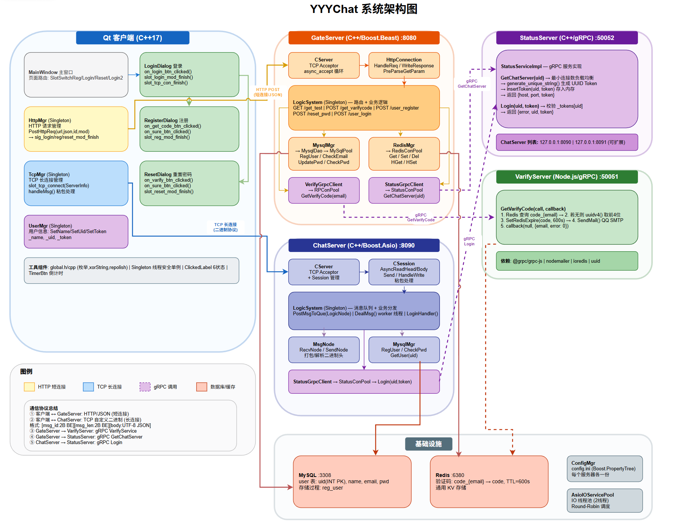

# YYYChat — 即时通讯系统

​	考虑到目前的服务器端已经较为完善，本项目还剩的一半内容大多数都是一些要基于客户端业务来完成的内容，所以在此先总览一下我们客户端与服务端之间的一些交互与系统架构

## 系统架构图



---

## 项目概述

YYYChat 是一个基于 C++/Qt 客户端 + 微服务后端架构的即时通讯（IM）系统。后端采用 **四微服务** 架构，服务间通过 **gRPC** 进行内部通信，客户端与服务端之间采用 **HTTP（短连接） + TCP（长连接）** 混合通信模式。

---

## 技术栈

| 模块 | 技术 |
|------|------|
| 客户端 | Qt 6.5.3 (C++), MinGW 64-bit |
| 网关服务 (GateServer) | C++, Boost.Beast (HTTP), Boost.Asio |
| 聊天服务 (ChatServer) | C++, Boost.Asio (TCP) |
| 状态服务 (StatusServer) | C++, gRPC |
| 验证码服务 (VarifyServer) | Node.js, gRPC, Nodemailer |
| 数据库 | MySQL |
| 缓存 | Redis |

---

## 项目目录结构

```
YYYChat/
├── client/                     # 客户端
│   └── YYYchat/
│       ├── main.cpp            # 入口，加载QSS样式和配置
│       ├── mainwindow.h/cpp    # 主窗口
│       ├── logindialog.h/cpp   # 登录对话框
│       ├── registerdialog.h/cpp# 注册对话框
│       ├── resetdialog.h/cpp   # 重置密码对话框
│       ├── chatdialog.h/cpp    # 聊天对话框
│       ├── httpmgr.h/cpp       # HTTP请求管理器（与GateServer通信）
│       ├── tcpmgr.h/cpp        # TCP长连接管理器（与ChatServer通信）
│       ├── usermgr.h/cpp       # 用户信息管理
│       ├── global.h/cpp        # 全局定义（请求ID、错误码等）
│       ├── singleton.h         # 单例模板
│       ├── clickedbtn.h/cpp    # 自定义可点击按钮
│       ├── clickedlabel.h/cpp  # 自定义可点击标签
│       └── timerbtn.h/cpp      # 带倒计时的按钮
│
└── server/                     # 服务端
    ├── GateServer/             # 网关服务 (C++, Boost.Beast, 端口8080)
    │   ├── GateServer.cpp      # 入口
    │   ├── CServer.h/cpp       # HTTP服务器
    │   ├── HttpConnection.h/cpp# HTTP连接处理
    │   ├── LogicSystem.h/cpp   # 路由注册 + 业务逻辑（登录/注册/重置密码）
    │   ├── VerifyGrpcClient.h/cpp  # → VarifyServer 的gRPC客户端（连接池）
    │   ├── StatusGrpcClient.h/cpp  # → StatusServer 的gRPC客户端（连接池）
    │   ├── MysqlMgr.h/cpp      # MySQL连接管理
    │   ├── MysqlDao.h/cpp      # MySQL数据访问
    │   ├── RedisMgr.h/cpp      # Redis连接管理
    │   ├── ConfigMgr.h/cpp     # 配置管理
    │   └── AsioIOServicePool.h/cpp  # IO线程池
    │
    ├── ChatServer/             # 聊天服务 (C++, Boost.Asio TCP)
    │   ├── ChatServer.cpp      # 入口
    │   ├── CServer.h/cpp       # TCP服务器（接收长连接）
    │   ├── CSession.h/cpp      # 会话管理
    │   ├── LogicSystem.h/cpp   # 消息队列 + 业务逻辑分发
    │   ├── MsgNode.h/cpp       # 消息节点（收发缓冲区）
    │   ├── StatusGrpcClient.h/cpp  # → StatusServer 的gRPC客户端（token校验）
    │   ├── MysqlMgr.h/cpp      # MySQL连接管理
    │   ├── MysqlDao.h/cpp      # MySQL数据访问（用户查询）
    │   ├── RedisMgr.h/cpp      # Redis连接管理
    │   ├── ConfigMgr.h/cpp     # 配置管理
    │   ├── AsioIOServicePool.h/cpp  # IO线程池
    │   └── const.h / data.h    # 常量与数据结构定义
    │
    ├── StatusServer/           # 状态服务 (C++, gRPC)
    │   ├── StatusServer.cpp    # 入口，启动gRPC服务器
    │   ├── StatusServiceImpl.h/cpp # gRPC服务实现：
    │   │                        #   - GetChatServer: 负载均衡返回ChatServer地址+Token
    │   │                        #   - Login: Token校验
    │   ├── MysqlMgr.h/cpp      # MySQL连接管理
    │   ├── MysqlDao.h/cpp      # MySQL数据访问
    │   ├── RedisMgr.h/cpp      # Redis连接管理
    │   ├── ConfigMgr.h/cpp     # 配置管理
    │   └── AsioIOServicePool.h/cpp  # IO线程池
    │
    └── VarifyServer/           # 验证码服务 (Node.js, gRPC, 端口50051)
        ├── server.js           # gRPC服务器入口
        ├── proto.js            # Proto文件加载
        ├── email.js            # 邮件发送（QQ SMTP + Nodemailer）
        ├── redis.js            # Redis操作封装（ioredis）
        ├── config.js           # 配置加载
        ├── const.js            # 常量定义
        └── message.proto       # gRPC协议定义
```

---

## 架构详解

### 1. 整体通信架构

```
┌──────────┐                  ┌──────────────┐
│  客户端   │─── HTTP ───────→│  GateServer  │
│  (Qt)    │                  │  (端口8080)   │
│          │─── TCP ───────→ │              │
└──────────┘                  └──────┬───────┘
                                     │ gRPC
                            ┌────────┼────────┐
                            ↓        ↓        ↓
                     ┌──────────┐ ┌──────────┐ ┌──────────┐
                     │VarifyServer│ │StatusServer│ │ChatServer│
                     │ (Node.js) │ │  (C++)    │ │  (C++)   │
                     │ :50051    │ │ gRPC      │ │ TCP      │
                     └────┬─────┘ └─────┬─────┘ └──────────┘
                          │             │
                     ┌────┴─────┐  ┌────┴─────┐
                     │  Redis   │  │  MySQL   │
                     └──────────┘  └──────────┘
```

- **客户端 ↔ GateServer**：HTTP 短连接，处理登录、注册、重置密码、获取验证码
- **客户端 ↔ ChatServer**：TCP 长连接，处理实时消息收发
- **GateServer ↔ VarifyServer**：gRPC，获取邮箱验证码
- **GateServer ↔ StatusServer**：gRPC，获取可用ChatServer地址 + 登录Token
- **ChatServer ↔ StatusServer**：gRPC，校验用户Token合法性

---

### 2. GateServer — 网关服务

GateServer 是整个系统的**统一入口**，基于 Boost.Beast 实现 HTTP 服务，监听 **8080 端口**。

**核心设计：**
- `LogicSystem` 采用 **URL 路由注册机制**，将不同路径映射到对应的 Handler
- 每个 HTTP 请求由 `HttpConnection` 异步处理，60 秒超时保护
- 通过 gRPC 连接池（`RPConPool` / `StatusConPool`）复用与下游服务的连接

**路由表：**

| 方法 | 路径 | 功能 | 下游调用 |
|------|------|------|----------|
| POST | `/get_varifycode` | 获取邮箱验证码 | gRPC → VarifyServer |
| POST | `/user_register` | 用户注册 | Redis（校验验证码）→ MySQL（写入用户） |
| POST | `/user_login` | 用户登录 | MySQL（校验密码）→ gRPC → StatusServer（获取ChatServer地址+Token） |
| POST | `/reset_pwd` | 重置密码 | Redis（校验验证码）→ MySQL（更新密码） |

```
请求进入 → CSession读取 → HttpConnection解析HTTP
    → LogicSystem路由分发 → Handler处理
        → gRPC调用下游 / MySQL查询 / Redis查询
    → 响应写回客户端
```

---

### 3. VarifyServer — 验证码服务

基于 **Node.js + gRPC**，监听 **50051 端口**，仅暴露一个 RPC：

```
GetVarifyCode(email) → (email, error)
```

**处理逻辑：**
1. 收到请求 → 先查 Redis 是否存在该邮箱的验证码
2. 不存在 → 生成 UUID 前4位作为验证码 → 存入 Redis（600秒过期）
3. 通过 QQ SMTP（Nodemailer）发送验证码邮件
4. 返回结果

```
┌─────────────┐      ┌──────────┐      ┌──────────┐
│ GateServer  │─gRPC→│ server.js│      │  Redis   │
│ (C++)       │      │          │←────→│ (缓存)   │
└─────────────┘      │ GetVarify│      └──────────┘
                     │  Code()  │
                     │          │      ┌──────────┐
                     │          │────→│ QQ SMTP  │
                     └──────────┘      │ (发邮件)  │
                                       └──────────┘
```

---

### 4. StatusServer — 状态服务

基于 **C++ + gRPC**，是系统的**注册中心 + 负载均衡器**。

**暴露两个 RPC：**

| RPC | 功能 |
|-----|------|
| `GetChatServer(uid) → (host, port, token, error)` | 返回当前连接数最少的 ChatServer 地址，生成 UUID Token |
| `Login(uid, token) → (uid, token, error)` | 校验 Token 是否匹配 |

**负载均衡策略：**
- 启动时从配置文件加载所有 ChatServer 实例信息
- `GetChatServer` 采用**最少连接数（Least Connection）**算法选择 ChatServer
- 每次分配时生成唯一的 UUID Token，存入内存映射表 `_tokens`
- ChatServer 收到客户端连接后，调用 `Login` RPC 二次校验 Token

```
                  ┌──────────────────┐
                  │   StatusServer   │
                  │                  │
 GateServer ─────→│ GetChatServer()  │──→ 选择最少连接的ChatServer
 (登录时)         │                  │    生成Token，记录uid↔token
                  │                  │
 ChatServer ─────→│ Login()          │──→ 校验token是否匹配
 (校验时)         │                  │
                  └──────────────────┘
```

---

### 5. ChatServer — 聊天服务

基于 **C++ + Boost.Asio** 的 TCP 长连接服务器。

**核心设计：**
- `CServer` 监听端口，接受 TCP 连接，每个连接由 `CSession` 管理
- `LogicSystem` 内部维护一个**消息队列 + 工作线程**的消费者模型：
  - CSession 收到数据包后 `PostMsgToQue()` 投递到队列
  - 工作线程 `DealMsg()` 循环取出消息，根据 `msg_id` 分发到对应回调

```
CSession收包 → 解析MsgNode → PostMsgToQue(LogicNode)
    → LogicSystem::DealMsg() 工作线程
        → _fun_callbacks[msg_id] 回调分发
            → LoginHandler / 其他业务Handler
```

**登录流程（ChatServer侧）：**
1. 客户端 TCP 连接 → 发送 `MSG_CHAT_LOGIN`（含 uid + token）
2. ChatServer 通过 gRPC 调用 `StatusServer::Login()` 校验 token
3. 校验通过 → 查 MySQL 获取用户信息 → 缓存到内存 `_users` → 返回登录成功

---

### 6. 客户端 — Qt 桌面应用

基于 **Qt 6.5.3**，采用 **CRTP 单例模式** 管理各模块。

**核心管理器：**

| 管理器 | 职责 |
|--------|------|
| `HttpMgr` | 封装 HTTP POST，通过信号槽异步回调，按 `Modules` 枚举区分业务模块 |
| `TcpMgr` | TCP 长连接管理，收发二进制消息包（msg_id + len + data），信号驱动 |
| `UserMgr` | 用户信息缓存 |

**HTTP 请求流程（以登录为例）：**
```
LoginDialog → HttpMgr::PostHttpReq(ID_LOGIN_USER, json)
    → QNetworkAccessManager::post → GateServer /user_login
    → 响应返回 → HttpMgr解析 → sig_login_mod_finish信号
    → LoginDialog接收 → 拿到(host, port, token, uid)
    → 触发TcpMgr连接ChatServer → TCP长连接建立
```

**协议枚举（ReqId）：**
- `1001` 获取验证码
- `1002` 注册用户
- `1003` 重置密码
- `1004` 用户登录
- `1005` 聊天登录（TCP）
- `1006` 聊天登录回包

---

## 数据流示意

### 用户注册流程

```
客户端                     GateServer                VarifyServer      Redis    MySQL
  │                           │                          │               │        │
  │──POST /get_varifycode────→│                          │               │        │
  │                           │──gRPC GetVarifyCode─────→│               │        │
  │                           │                          │──SET key+TTL─→│        │
  │                           │                          │──发邮件───────→│        │
  │                           │←─────── 返回 ───────────│               │        │
  │←── 返回 ─────────────────│                          │               │        │
  │                           │                          │               │        │
  │──POST /user_register─────→│                          │               │        │
  │                           │──GET verify_code───────────────────────→│        │
  │                           │←── 验证码 ──────────────────────────────│        │
  │                           │──RegUser()────────────────────────────→│        │
  │                           │←── uid ────────────────────────────────│        │
  │←── 注册成功 ──────────────│                          │               │        │
```

### 用户登录流程

```
客户端                     GateServer                StatusServer    MySQL
  │                           │                          │             │
  │──POST /user_login────────→│                          │             │
  │                           │──CheckPwd()──────────────────────────→│
  │                           │←── UserInfo ──────────────────────────│
  │                           │──gRPC GetChatServer(uid)─→│           │
  │                           │                          │ 选择最少连接 │
  │                           │                          │ 的ChatServer│
  │                           │                          │ 生成Token   │
  │                           │←── (host,port,token) ────│            │
  │←── 返回(host,port,token)──│                           │            │
  │                           │                          │            │
  │──TCP连接→ ChatServer ────→│                           │            │
  │──MSG_CHAT_LOGIN(uid,token)                            │           │
  │                           │──gRPC Login(uid,token)───→│           │
  │                           │←──  校验成功  ─────────────│            │
  │                           │──GetUser(uid)────────────────────────→│
  │←──  登录成功 ──────────────│                          │            │
```

---

## 设计细节

### Server

#### 服务划分

服务端分为四个独立的微服务，分别是 **GateServer**、**ChatServer**、**VarifyServer** 和 **StatusServer**，监听各自端口（可通过 `config.ini` 指定）。GateServer 和 ChatServer 由基于 Boost.Asio 的 `CServer` 实现，VarifyServer 为 Node.js gRPC 服务，StatusServer 为 C++ gRPC 服务。

| 服务 | 端口 | 传输协议 | 实现 |
|------|------|----------|------|
| GateServer | 8080 | HTTP | C++, Boost.Beast |
| ChatServer | 配置文件指定 | TCP 长连接 | C++, Boost.Asio |
| VarifyServer | 50051 | gRPC | Node.js, @grpc/grpc-js |
| StatusServer | 配置文件指定 | gRPC | C++, grpc |

#### IO 线程池（Reactor）

GateServer 和 ChatServer 各自持有独立的 `AsioIOServicePool`（基于单例模式），内部维护多个 `io_context` 实例（默认 2 个），每个 `io_context` 运行在独立线程上，构成 **多 Reactor 模型**。通过 `GetIOService()` 以 round-robin 方式分配连接，将新连接均匀分摊到各 Reactor 线程。

```
AsioIOServicePool
├── io_context[0] ──→ thread[0] ──→ epoll_wait
├── io_context[1] ──→ thread[1] ──→ epoll_wait
└── _nextIOService  ──→ round-robin 分发新连接
```

Reactor 线程只负责读写事件触发（`async_read` / `async_write`），业务逻辑由下游模块分发处理。

#### GateServer — HTTP 网关

GateServer 是整个系统的**统一入口**，基于 Boost.Beast 实现异步 HTTP 服务。

`CServer` 监听端口，`Start()` 中从 `AsioIOServicePool` 获取 `io_context`，创建 `HttpConnection` 并异步 accept。每个 HTTP 请求的生命周期：

1. `HttpConnection::Start()` → `async_read` 读取 HTTP 请求
2. `HandleReq()` 解析请求方法（GET/POST），提取 URL 和 Query 参数
3. 路由到 `LogicSystem` 的 Handler 映射表
4. Handler 执行业务逻辑（调用 gRPC / 查 Redis / 查 MySQL）
5. `WriteResponse()` 写回 HTTP 响应，关闭连接

**连接超时机制**：每个 `HttpConnection` 创建时注册一个 60 秒定时器（`deadline_`），到期自动关闭 socket，防止空闲连接泄漏。

**路由注册**：`LogicSystem` 在构造函数中通过 `RegPost()` / `RegGet()` 注册路由回调，采用 `std::map<std::string, HttpHandler>` 存储，支持精确匹配。

```
LogicSystem 构造函数内注册：
  /get_varifycode  →  GetVarifyHandler
  /user_register   →  RegisterHandler
  /user_login      →  LoginHandler
  /reset_pwd       →  ResetPwdHandler
```

#### ChatServer — 聊天服务

ChatServer 是基于 Boost.Asio 的 TCP 长连接服务器。

`CServer` 内部维护一个 `std::map<std::string, shared_ptr<CSession>> _sessions`，以 UUID 为 key 管理所有活跃连接。每个客户端连接分配一个 UUID（`boost::uuids::random_generator()`），连接断开时通过 `ClearSession()` 移除。

**CSession — 连接元模块**

`CSession` 是用户连接真正的元模块，每个已登录用户持有一条 TCP 会话。封装了 socket 的读写操作，解决了非阻塞模式下的 **TCP 粘包、半包** 问题。

**自定义二进制协议（4字节定长头 + 变长体）：**

```
┌────────────────┬────────────────┐
│  HEAD (4 bytes)│  BODY (变长)    │
├────────┬───────┤                │
│ msg_id │msg_len│   JSON data    │
│(2bytes)│(2bytes)│                │
└────────┴───────┴────────────────┘
```

粘包/半包解决策略：
- **读头**（`AsyncReadHead`）：循环 `async_read_some` 直到读满 4 字节头部
- **读体**（`AsyncReadBody`）：根据头部 `msg_len` 读满指定长度
- **写队列**（`_send_que`）：异步写互斥锁保护，前一个写完成后自动触发队列中下一个写
- 网络字节序：收发均使用 `network_to_host_short` / `BigEndian` 转换

**LogicSystem — 消息分发**

`LogicSystem` 采用 **生产者-消费者** 模式，内部维护一个消息队列 + 工作线程：

```
CSession::AsyncReadBody 完成
    → PostMsgToQue(LogicNode)        // 生产者：网络线程投递
        → _msg_que.push()
        → cond.notify_one()

LogicSystem::DealMsg()              // 消费者：独立工作线程
    → while (!_b_stop)
        → msg = _msg_que.front()
        → _fun_callbacks[msg_id]()  // 根据消息ID回调分发
        → _msg_que.pop()
```

回调注册在 `RegisterCallBacks()` 中，通过 `std::map<short, FunCallBack>` 映射。当前已注册的回调：

```
MSG_CHAT_LOGIN (1005) → LoginHandler
```

`LoginHandler` 处理流程：
1. 解析 JSON → 提取 uid + token
2. 通过 gRPC 调用 `StatusServer::Login()` 校验 Token
3. 校验通过 → 查内存缓存 `_users`，未命中则查 MySQL → 缓存
4. 使用 `Defer` 机制确保无论成功/失败都向客户端发送 `MSG_CHAT_LOGIN_RSP`

#### VarifyServer — 验证码服务

基于 **Node.js + gRPC**，仅暴露一个 RPC：

```
GetVarifyCode(email) → (email, error)
```

**处理逻辑：**
1. 先查 Redis 是否存在该邮箱的验证码
2. 不存在 → `uuid.v4()` 取前 4 位 → 存入 Redis（600 秒过期）
3. 通过 QQ SMTP（Nodemailer）发送验证码邮件
4. 返回结果

验证码为 4 位 UUID 前缀，5 分钟内有效。邮件发送方地址和授权码配置在服务器 Redis 中，部署时设定。

#### StatusServer — 状态服务

基于 **C++ + gRPC**，充当系统的轻量级**注册中心 + 负载均衡器**。

暴露两个 RPC：

| RPC | 入参 | 出参 | 功能 |
|-----|------|------|------|
| `GetChatServer` | uid | host, port, token, error | 返回最少连接的 ChatServer + 生成 UUID Token |
| `Login` | uid, token | uid, token, error | 校验 Token 合法性 |

**负载均衡**：构造函数从 `config.ini` 加载所有 ChatServer 实例（如 `ChatServer1`、`ChatServer2`），`GetChatServer` 遍历选择连接数最少的实例（Least Connection），生成 UUID Token 并记录到内存映射 `_tokens[uid] = token`。ChatServer 收到客户端 TCP 连接后调用 `Login` 二次校验，防止 Token 伪造。

**内存数据结构：**
```
_servers: map<name, ChatServer{host, port, con_count}>
_tokens:  map<uid, token>   // Token映射表
```

#### gRPC 连接池

GateServer 对 VarifyServer 和 StatusServer 的 gRPC 调用均采用连接池模式，避免每次请求重新建连：

- `RPConPool`（VarifyServer）：管理 `VarifyService::Stub` 的连接队列
- `StatusConPool`（StatusServer）：管理 `StatusService::Stub` 的连接队列

通过 `条件变量 + 互斥锁` 实现生产者-消费者模型：`getConnection()` 在队列为空时阻塞等待，`returnConnection()` 归还连接并唤醒等待者。`Close()` 设置停止标志并唤醒全部等待者，安全退出。

#### Redis 连接池与心跳

`RedisConPool` 管理 hiredis 同步连接的复用队列。构造函数中初始化所有连接并完成 AUTH 认证。额外启动一个守护线程（`check_thread_`），每 60 秒对池中所有连接发送 `PING` 命令进行心跳保活，断开的连接自动重连并重新认证。

封装的 Redis 操作（`RedisMgr`）：`Get`、`Set`、`LPush`、`LPop`、`RPush`、`RPop`、`HSet`、`HGet`、`Del`、`ExistsKey`。

#### MySQL 数据访问

采用 DAO 模式，`MysqlDao` 封装底层数据库操作（如 `RegUser`、`CheckEmail`、`CheckPwd`、`UpdatePwd`、`GetUser`），`MysqlMgr` 通过单例对外暴露业务接口。查询到的用户信息映射到 `UserInfo` 结构体（uid, name, pwd, email）。

#### 配置管理

`ConfigMgr` 基于 `boost::property_tree` 解析 INI 格式配置文件，采用 Meyers Singleton。`SectionInfo` 封装 section 内的 key-value 映射。服务启动时读取各自的端口、数据库地址、Redis 地址等信息。配置文件路径通过程序参数或默认路径指定。

---

### Client

#### 通信架构

客户端基于 **Qt 6.5.3**，采用 `HTTP 短连接 + TCP 长连接` 混合通信：

- **HttpMgr**：封装 `QNetworkAccessManager`，通过信号槽实现异步 HTTP 回调。按 `Modules` 枚举区分业务模块（REGISTERMOD / RESETMOD / LOGINMOD），请求完成后由 `slot_http_finish` 按模块分发信号到对应的 Dialog。

- **TcpMgr**：封装 `QTcpSocket` 长连接。发送侧以 `msg_id(2B) + msg_len(2B) + JSON body` 二进制打包（网络字节序 BigEndian）。接收侧通过 `_buffer` 缓存 + `_b_recv_pending` 状态机处理粘包/半包，解析完整包后按 `_handlers` 映射表分发回调。

#### 接收缓冲区状态机

```
forever:
  if (!_b_recv_pending):
    if buffer.size() < 4 → return (等数据)
    stream >> msg_id >> msg_len
    buffer = buffer.mid(4)

  if buffer.size() < msg_len:
    _b_recv_pending = true → return (等数据)

  _b_recv_pending = false
  body = buffer.mid(0, msg_len)
  buffer = buffer.mid(msg_len)
  handleMsg(msg_id, msg_len, body)
```

#### 回调分发

`_handlers` 是一个 `QMap<ReqId, std::function>`，在 `initHandlers()` 中注册。当前注册的回调：

```
ID_CHAT_LOGIN_RSP (1006) → 解析 JSON，提取 uid/name/token，
                             写入 UserMgr，发出 sig_switch_chatdlg 切换界面
```

#### 信号驱动流程（以登录为例）

```
LoginDialog(UI点击)
  → HttpMgr::PostHttpReq(ID_LOGIN_USER, json)
    → QNetworkAccessManager::post → GateServer /user_login
    → QNetworkReply::finished
      → emit sig_http_finish
        → slot_http_finish → emit sig_login_mod_finish

LoginDialog 接收 sig_login_mod_finish
  → 解析拿到 {host, port, token, uid}
  → emit sig_connect_tcp(ServerInfo)
    → TcpMgr::slot_tcp_connect → _socket.connectToHost()

TCP 连接成功
  → emit sig_send_data(ID_CHAT_LOGIN, json{uid, token})
    → TcpMgr::slot_send_data → 二进制打包 → _socket.write()

ChatServer 返回
  → TcpMgr 接收 → handleMsg → _handlers[ID_CHAT_LOGIN_RSP]
    → 写入 UserMgr → emit sig_switch_chatdlg → 切换到聊天界面
```

#### 线程模型

Qt 的事件循环运行在主线程（`QCoreApplication::exec()`）。网络 IO（HTTP / TCP）使用 Qt 内部的异步机制，不阻塞 UI。信号槽跨线程通信由 Qt 的 `QueuedConnection` 自动处理。

#### 本地存储

客户端不与服务端数据库直连。聊天记录、用户关系网等信息使用 SQLite 存储在本地。

#### 日志输出

服务端通过 `std::cout` / `std::cerr` 实时输出运行日志至控制台。客户端使用 `qDebug()` 输出日志。

---

### 注册流程

用户需使用邮箱注册。服务端采用 QQ 邮箱 SMTP 发送验证码，部署时在 `config.js` 中配置发送方邮箱地址和 SMTP 授权码。

1. 用户在客户端输入邮箱 → 请求 `POST /get_varifycode`
2. GateServer 通过 gRPC 调用 VarifyServer
3. VarifyServer 生成 4 位验证码（UUID 前 4 位），存入 Redis（600 秒 / 5 分钟过期）
4. 通过 QQ SMTP 发送验证码邮件
5. 用户输入验证码 + 用户名 + 密码 + 确认密码 → 请求 `POST /user_register`
6. GateServer 先从 Redis 取出验证码比对，校验通过后写入 MySQL
7. 返回注册成功

---

## 关键技术点

1. **gRPC 连接池**：GateServer 对 VarifyServer 和 StatusServer 的 gRPC 调用均采用连接池（`RPConPool` / `StatusConPool`），配合条件变量实现连接复用，减少频繁建连开销。

2. **异步 IO 池化**：ChatServer 和 GateServer 均使用 `AsioIOServicePool` 管理多个 `io_context`，每个 `io_context` 运行在独立线程上，以 round-robin 分配连接，提升并发处理能力。

3. **消息队列解耦**：ChatServer 的 `LogicSystem` 采用生产者-消费者模式，网络层收到数据后投递到队列，逻辑线程独立消费，网络 IO 和业务逻辑完全解耦。

4. **Token 二次校验**：客户端登录时，先通过 HTTP 从 StatusServer 获取 Token，再通过 TCP 向 ChatServer 发起连接并携带 Token，ChatServer 再通过 gRPC 向 StatusServer 校验 Token 合法性，防止 Token 伪造。

5. **非阻塞 TCP 粘包/半包处理**：服务端 `CSession` 和客户端 `TcpMgr` 各自实现了定长头（4 字节 msg_id + msg_len）+ 变长体的二进制协议，通过状态机和缓冲区循环读取解决粘包/半包问题。

6. **CRTP 单例模式**：客户端各 Manager 类通过 `Singleton<T>` 模板实现类型安全的单例（`HttpMgr`、`TcpMgr`、`UserMgr`），服务端同样使用单例模式管理各组件生命周期（`LogicSystem`、`ConfigMgr`、`AsioIOServicePool`、`RedisMgr`、`MysqlMgr`、`StatusGrpcClient`、`VerifyGrpcClient`）。

7. **Redis 连接池健康检查**：服务端 `RedisConPool` 启动独立守护线程，每 60 秒 PING 所有连接，断开的连接自动重连并重新 AUTH 认证。

8. **QSS 主题**：客户端通过外挂 QSS 样式表实现 UI 主题定制，`repolish` 函数支持运行时刷新样式。
